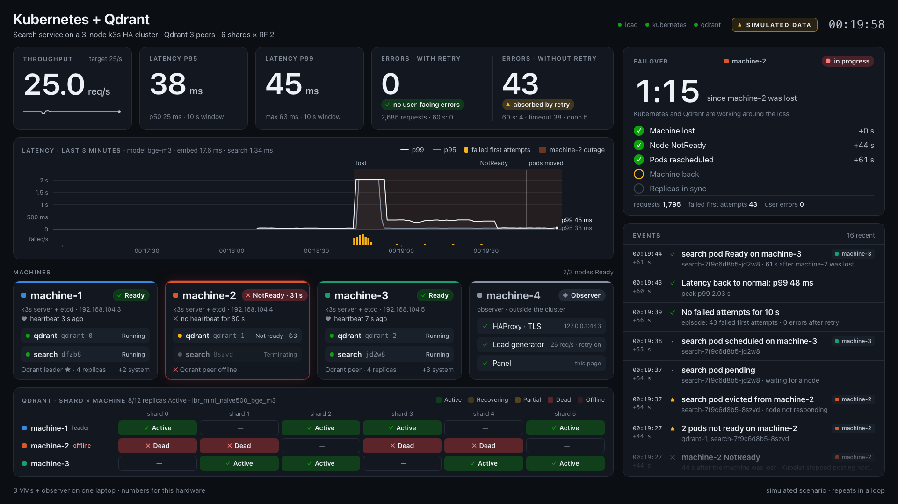

# Панель и генератор нагрузки

Панель для ролика «Kubernetes + Qdrant»: под ровной нагрузкой выключаем machine-2 и смотрим, как растёт p99,
узел уходит в NotReady, поды переезжают, а пользователь ошибок не видит; машина возвращается — реплики
Qdrant догоняют, на экране время восстановления. Только стандартная библиотека Python (3.12+) и ванильный
JS: ничего не скачивается, шрифтов и CDN нет.



| Файл | Что это |
|---|---|
| `loadgen.py` | генератор нагрузки на asyncio, пишет статистику в JSON-файл |
| `aggregator.py` | HTTP-сервер: статика панели, `GET /api/state`, `POST /api/event`; сборка состояния, события, хронология сбоя |
| `sources.py` | источники, каждый — свой класс: `LoadSource`, `KubeSource`, `QdrantSource`, `ServiceChecks`, `EventsSource` |
| `mockstand.py` | `MockSource`: сценарий «machine-2 выключена» по кругу, без кластера |
| `static/index.html` | панель 1920×1080, CSS и JS внутри, графики на canvas |
| `questions.txt` | вопросы для генератора (по строке, по кругу) |
| `tests/` | тесты на `unittest` и примеры JSON (`tests/fixtures/`) |

## Mock на Маке

```bash
python3 -I -B panel/aggregator.py --mock
open http://127.0.0.1:8090/
```

- `--mock-start 80` — начать с 80-й секунды сценария; история графика, лента и хронология дорисуются.
- `--port 8091` — другой порт. Остановить — Ctrl+C.
- `http://127.0.0.1:8090/?still` — без анимаций (для скриншотов). Окно любого размера: сцена 1920×1080
  масштабируется целиком.
- В mock-режиме на панели всегда плашка **SIMULATED DATA**: числа правдоподобны, но выдуманы.

Сценарий, секунды круга (165 с, потом повтор):

| с | Что происходит |
|---|---|
| 0–20 | норма: 3 узла Ready, 12/12 реплик Active, 25 req/s, p99 ≈ 45 мс |
| 20 | machine-2 выключена: пир Qdrant молчит, первые попытки к ней висят до таймаута 2 с, повтор спасает; p99 ≈ 2 с |
| 23 | реплики на machine-2 — Dead |
| 27–66 | балансировщик убрал machine-2, но часть трафика ещё идёт на её поды: p99 ≈ 0,3 с |
| 30 | у kubelet нет пульса (аренда не продлевается 15 с), Kubernetes всё ещё считает узел Ready |
| 64 | узел NotReady (+44 с) |
| 74–81 | под search выселен, новый Ready на machine-3 (+61 с) |
| 100 | machine-2 включена; 116 — узел Ready (+96 с); 120 — пир Qdrant отвечает |
| 121–135 | 4 шарда догоняют по очереди; все реплики Active (+115 с, восстановление 19 с) |
| 140 | только в mock: под search возвращается на machine-2, чтобы круг начинался так же |

Mock подменяет только транспорт: отдаёт JSON как `kubectl get nodes,pods -A -o json` и как Qdrant
`/cluster`, а синтетические запросы пишет в тот же `Stats`, что и настоящий генератор. Разбор, карта
шардов, события и хронология — тот же код, что с живым кластером.

## Живые источники на machine-4

### 1. Генератор нагрузки

```bash
python3 -I -B panel/loadgen.py \
  --url https://127.0.0.1/search --cafile /etc/stand/ca.pem \
  --rate 25 --concurrency 64 --timeout 2 --retry other \
  --questions panel/questions.txt --stats-file /run/user/$(id -u)/panel-load.json
```

| Параметр | По умолчанию | Смысл |
|---|---|---|
| `--url` | — | цель; можно несколько раз: первые попытки идут по кругу, повтор — на следующую |
| `--rate` | 20 | запросов в секунду, ровно (open loop: темп не зависит от ответов) |
| `--concurrency` | 64 | потолок одновременных запросов; сверх него запрос не уходит и считается `skipped` |
| `--timeout` | 2 | таймаут одной попытки, с |
| `--retry` | `other` | `none` — без повтора; `other` — один повтор на другую цель (если цель одна — на неё же) |
| `--questions` | `panel/questions.txt` | вопросы по строке; `#` и пустые строки пропускаются; 3–500 знаков |
| `--k` | 5 | сколько результатов просить |
| `--stats-file` | — | куда писать снимок для панели (раз в `--interval` = 0,5 с, атомарно) |
| `--cafile` / `--insecure` | — | свой корневой сертификат / не проверять сертификат (только для стенда) |
| `--arrival` | `uniform` | `poisson` — случайные промежутки с тем же средним темпом |
| `--duration`, `--smooth`, `--no-keepalive`, `--quiet` | | остановка через N с, окно сглаживания ряда, без keep-alive, без сводки в консоль |

Повторяются только «временные» сбои: таймаут, обрыв или отказ соединения, 5xx, битый ответ; 4xx — нет.
Каждый запрос учитывается дважды: `without_retry` — исход первой попытки (что увидел бы пользователь без
повтора), `with_retry` — итог после повтора (что он получил). Задержка — от начала первой попытки до
итогового ответа, вместе с повтором. Поэтому один прогон с `--retry other` даёт обе цифры ролика сразу.

С одной целью (HAProxy) повтор уходит на тот же вход, а обходит мёртвую машину уже HAProxy. Чтобы показать
именно «повтор на другую цель», дайте несколько `--url` — по адресу на машину.

Из ответов сервиса генератор берёт `model` и `collection` (и `timing_ms`): над графиком видно, какая модель
отвечала последние 10 с и сколько заняли векторизация и поиск. При смене модели через алиас коллекции под
нагрузкой там же видна доля старой и новой («bge-m3 62% · e5 38%»).

**Как статистика попадает в панель.** Генератор и агрегатор — отдельные процессы, их можно перезапускать
по одному. Генератор раз в 0,5 с пишет снимок во временный файл рядом и переименовывает его в
`--stats-file` (читатель не увидит половину), агрегатор читает файл раз в 0,5 с. Снимок старше 3 с или с
`"running": false` — «генератор остановлен».

### 2. Агрегатор

```bash
python3 -I -B panel/aggregator.py --bind 127.0.0.1 --port 8090 \
  --load-stats /run/user/$(id -u)/panel-load.json \
  --kubectl /usr/local/bin/kubectl --kubeconfig ~/.kube/panel-readonly.yaml \
  --kube-server https://lima-machine-1.internal:6443 \
  --kube-server https://lima-machine-3.internal:6443 \
  --kube-server https://lima-machine-2.internal:6443 \
  --qdrant http://<адрес пира на machine-1>:6333 \
  --qdrant http://<адрес пира на machine-2>:6333 \
  --qdrant http://<адрес пира на machine-3>:6333 \
  --qdrant-key-file ~/.config/stand/qdrant-read-only-key \
  --qdrant-collection lbr_mini_naive500_bge_m3 \
  --observer-check 'HAProxy · TLS=127.0.0.1:443' \
  --event-token-file ~/.config/stand/panel-event-token
```

Источник включается, если заданы его параметры; без них блок панели честно пишет «not connected».

| Источник | Параметры | Что нужно от стенда |
|---|---|---|
| load | `--load-stats FILE` | путь из `loadgen.py --stats-file` |
| kube | `--kubectl`, `--kubeconfig`, `--kube-server` (несколько — запасные), `--kube-context`, `--kube-timeout` (4 с), `--kube-namespaces` (`search,qdrant`), `--no-kube-leases` | kubeconfig с правами только на чтение: `get, list` на `nodes`, `pods` (все ns) и `leases` в `kube-node-lease` |
| qdrant | `--qdrant [машина=]URL` (по одному на пир), `--qdrant-key-file`, `--qdrant-collection` (коллекция или алиас), `--qdrant-peer peer_id=машина`, `--qdrant-timeout` (1,5 с), `--qdrant-cafile`, `--qdrant-insecure` | адрес каждого пира с machine-4 и ключ **только на чтение** в файле |
| observer | `--observer-check ИМЯ=хост:порт` | TCP-проверка служб machine-4 (HAProxy) |
| events | `--event-token-file FILE` | токен для внешних событий; без него `POST /api/event` — только с localhost |

Оформление: `--machines` (порядок карточек, имена = имена узлов k8s), `--observer` (`machine-4`),
`--title`, `--subtitle`, `--caption`, `--spike-ms` (порог события «всплеск p99», 250 мс),
`--lease-stale` (пульс старше 15 с — «нет пульса»), `--verbose` (журнал HTTP).

Как устроены живые источники:

- **kube.** `kubectl get nodes,pods -A -o json` раз в 2 с и отдельно `kubectl get leases -n
  kube-node-lease -o json` (пульс kubelet: по нему «нет пульса» видно раньше NotReady). У kubectl свой
  `--request-timeout`, у процесса — жёсткий таймаут: зависший API не держит панель, показываются последние
  удачные данные с пометкой «data N s old». Если текущий `--kube-server` не ответил, берётся следующий и
  остаётся текущим. Поставьте первым сервер, который в ролике не выключается.
- **qdrant.** Каждый пир — `GET /cluster` и `GET /collections/{c}/cluster` (заголовок `api-key`, ключ
  читается из файла и перечитывается при замене файла; в журналы и в состояние не попадает), пиры
  опрашиваются параллельно. Алиас коллекции разрешается через `GET /aliases`, на панели видно «alias →
  collection» (сцена со сменой модели). Номер пира → машина: `--qdrant-peer` > под Kubernetes по адресу
  пира (`qdrant-1.qdrant-headless` → под `qdrant-1` → его узел; или IP пода) > машина у `--qdrant`.
  Адреса нужны **по пиру** (Service на под через селектор `statefulset.kubernetes.io/pod-name`, или NodePort
  с `externalTrafficPolicy: Local`): через общий балансирующий Service доступность отдельного пира видна
  только по `message_send_failures` консенсуса.
- **events.** Переходы выводит сам агрегатор (узлы, поды, реплики, нагрузка, здоровье источников).
  Внешние события — `POST /api/event`, например из Falco:

  ```yaml
  # falco.yaml
  json_output: true
  http_output:
    enabled: true
    url: "http://<machine-4>:8090/api/event?token=<токен из --event-token-file>"
  ```

Панель с Мака: `--bind 127.0.0.1` плюс проброс порта (Lima или `ssh -L`) — решение владельца стенда.

## Контракт `GET /api/state`

Один JSON на всю панель, собирается раз в 0,5 с, панель берёт его раз в секунду. Время — unix-секунды
(float), длительности — секунды, задержки — миллисекунды. Номера пиров Qdrant — **строки** (u64 не
помещается в число JavaScript). Поле, для которого нет источника, — `null`. Тест `tests/test_server.py`
сверяет набор ключей с этим описанием.

```
{
  "schema": "panel/1",
  "ts": 1763460391.5,             время сборки на сервере
  "mode": "live" | "mock",
  "ui": {"title", "subtitle", "caption"},
  "sources": {                    только подключённые источники
    "load"|"kube"|"qdrant"|"observer": {"ok": bool, "age_s": float|null, "error": str|null, "stale"?: bool}
  },
  "load": {...} | null,
  "machines": [...],
  "kube": {...} | null,
  "qdrant": {...} | null,
  "incident": {...} | null,
  "events": [...]
}
```

**`load`** — снимок генератора (формат `loadgen/1`, тот же пишет `loadgen.py`) плюс `age_s`, `stale`:

| Поле | Тип | Смысл |
|---|---|---|
| `schema`, `ts`, `started_at` | str, float, float | версия формата, время снимка, первый запрос |
| `source`, `running`, `inflight` | str, bool, int | `loadgen` или `mock`; идёт ли; запросов в полёте |
| `config` | obj | `targets[]`, `rate`, `concurrency`, `timeout_s`, `retry` (`none`/`other`), `k`, `arrival` |
| `windows` | obj | `"1s"`, `"10s"`, `"60s"` — окна по завершённым секундам (текущая неполная не входит) |
| `windows.*` | obj | `seconds`, `count`, `qps`, `p50_ms`, `p95_ms`, `p99_ms`, `max_ms`, `without_retry`, `with_retry`, `retries`, `skipped` |
| `…without_retry`, `…with_retry` | obj | `errors` (int), `rate` (доля), `by_kind`: `timeout`, `conn`, `5xx`, `4xx`, `bad` |
| `totals` | obj | с начала работы: `count`, `without_retry`, `with_retry`, `retries`, `skipped` |
| `series` | list | 180 точек, по секунде: `t`, `qps`, `p50`, `p95`, `p99` (по последним 5 с), `errors_without_retry`, `errors_with_retry`, `retries` (этой секунды) |
| `serving` | list | за 10 с: `model`, `collection`, `count`, `share` — какие модель и коллекция отвечали |
| `server_timing_ms` | obj\|null | за 10 с, среднее из `timing_ms` ответов: `embed`, `search` |
| `age_s`, `stale` | float, bool | возраст снимка; старше 3 с |

Перцентили — по ближайшему рангу (наблюдённое значение). `qps` — завершённые запросы в секунду.

**`machines[]`** — карточки в порядке `--machines`, затем узлы, которых нет в списке:

| Поле | Тип | Смысл |
|---|---|---|
| `name`, `color` | str | имя (= узел k8s), цвет машины (тот же на карте Qdrant, в ленте, на графике) |
| `role` | str | `server` (узел k3s), `observer`, `machine` (узла с таким именем нет) |
| `status` | str | `ready`, `unreachable` (Ready, но пульса kubelet нет дольше `--lease-stale`), `notready`, `unknown`, `observer` |
| `status_since` | float\|null | с какого времени статус (переход Ready или последний пульс) |
| `heartbeat_at`, `heartbeat_age_s` | float\|null | последнее продление аренды kubelet и его возраст |
| `ip` | str\|null | InternalIP узла |
| `kube` | obj\|null | `ready` (`True`/`False`/`Unknown`), `reason`, `message`, `roles[]`, `kubelet`, `unschedulable`, `taints[]` |
| `pods[]` | list | поды приложения (`--kube-namespaces`) на узле: `namespace`, `name`, `short`, `app`, `status` (как STATUS у kubectl), `state` (`ready`, `starting`, `notready`, `terminating`, `failed`), `ready`, `restarts`, `owner_kind`, `age_s` |
| `system_pods` | int | прочие поды на узле (без завершённых Job) |
| `qdrant` | obj\|null | пир на машине: `peer`, `pod`, `reachable`, `leader`, `replicas` (число по состояниям) |
| `services` | list\|null | только у наблюдателя: `name`, `ok` (true/false/null), `detail` |

**`kube`**: `ok`, `age_s`, `error`, `server` (какой API ответил), `heartbeats` (читаются ли аренды),
`nodes[]` (`name`, `ready`, `since`, `reason`, `unschedulable`, `taints`), `unscheduled[]` (поды без узла,
поля как в `pods[]`).

**`qdrant`**:

| Поле | Тип | Смысл |
|---|---|---|
| `ok` | bool | ответил хотя бы один пир |
| `collection`, `alias` | str, str\|null | настоящая коллекция и алиас, если задан алиасом |
| `status`, `points` | str\|null, int\|null | из `GET /collections/{c}`: green/yellow/red, число точек |
| `shard_count`, `replication_factor` | int | |
| `peers[]` | list | `id` (строка), `machine`, `pod`, `uri`, `reachable`, `leader` |
| `shards[]` | list | `id`, `replicas[]`: `peer`, `machine`, `state` (как у Qdrant: Active, Dead, Partial…), `display`, `progress` (0..1 у переноса), `from_machine` |
| `transfers[]` | list | `shard`, `from`, `to`, `from_machine`, `to_machine`, `method`, `sync`, `progress`, `comment` |
| `summary` | obj | число реплик по `display` + `total`, `healthy` (все Active, переносов нет, все пиры отвечают) |
| `raft` | obj | `leader`, `leader_machine`, `term`, `commit` |

`display` — состояние клетки на карте: `active`; `recovering` (Partial с идущим переносом, Recovery,
PartialSnapshot); `partial` (Partial без переноса, Initializing, Resharding); `dead`; `offline` — пир не
отвечает, а консенсус ещё числит реплику живой (без записей Qdrant помечает реплику Dead не сразу);
`listener`; `unknown`.

**`incident`** — последний сбой машины (остаётся на экране до следующего), `null` — сбоев не было:

| Поле | Тип | Смысл |
|---|---|---|
| `active`, `machine`, `color`, `phase` | bool, str, str, str | `phase` — последний пройденный этап |
| `started` | float | момент потери машины (оценка, см. ограничения) |
| `steps[]` | list | `key` (`lost`, `notready`, `moved`, `back`, `recovered`), `label`, `ts`, `done`, `offset_s` (от `started`); `moved` нет, если на машине не было подов Deployment |
| `elapsed_s` | float | от потери до сейчас (или до восстановления) |
| `downtime_s`, `recovery_s`, `total_s` | float\|null | потеря → возвращение; возвращение → все реплики Active (**время восстановления**); потеря → восстановление |
| `apps` | obj | приложения Deployment с машины и сколько их подов должно быть Ready в другом месте |
| `load` | obj | за время сбоя: `requests`, `without_retry`, `with_retry`, `p99_max` |

**`events[]`** — до 50 последних, новые первыми: `id`, `ts`, `kind` (`node`, `pod`, `replica`, `load`,
`source`, `security`, `scenario`, `info`), `level` (`info`, `ok`, `warn`, `error`), `title`, `detail`,
`machine`, `pod`, `source`, `count` (одинаковые события за 10 с склеиваются), `last_ts` (если склеивались).

### `POST /api/event`

Тело — JSON-объект или массив (до 50) не больше 64 КиБ. Ответ `201 {"ok": true, "ids": [...]}`; `400` —
не JSON или нет заголовка, `403` — нет токена (или не localhost), `413` — большое тело, `429` — больше
20 событий в секунду.

- Общий формат: `{"title": "Pod quarantined", "level": "ok", "kind": "security", "detail": "...",
  "machine": "machine-1", "pod": "search-…", "ts": 1763460391.5}` (обязателен только `title`).
- Формат Falco `http_output` узнаётся сам: `rule` → заголовок, `output` → подробности, `priority` →
  уровень, `hostname` → машина, `output_fields["k8s.pod.name"]` → под, `time` → время.
- Токен: заголовок `X-Panel-Token`, `Authorization: Bearer …` или `?token=` (для Falco).

Текст событий на панели выводится только как текст (`textContent`), страница отдаётся с CSP по хэшам
встроенных скрипта и стилей: чужая разметка из события не исполнится.

## Тесты

```bash
python3 -I -B -m unittest discover -s panel/tests -t panel
```

107 тестов, ~5 с, проходят на Python 3.14 и 3.12: перцентили и окна, учёт ошибок с повтором и без,
генератор с подменённым транспортом и с настоящим HTTP-сервером (повтор, keep-alive, «протухшее»
соединение), разбор kubectl и аренд, разбор Qdrant `/cluster` и `/collections/{c}/cluster` (карта,
доступность пиров, переносы, алиас, ключ только в заголовке), лента и формат Falco, хронология сбоя,
mock-сценарий целиком на два круга, HTTP-сервер и контракт `/api/state`.

## Ограничения

- Числа mock выдуманы под это железо; живые цифры дают только живые источники.
- Момент потери машины — оценка: пир Qdrant на ней перестал отвечать (±1 с) → иначе последний пульс
  kubelet + 5 с (±5 с) → иначе переход NotReady. Без Qdrant и без прав на `leases` отсчёт пойдёт от NotReady.
- Хронология ведёт одну машину за раз; второй сбой во время первого виден в ленте, но не в хронологии.
- Генератор: перцентили точные до 2000 запросов в секунду (дальше — выборка-резервуар); окна — по
  времени завершения запроса.
- Агрегатор вызывает kubectl раз в 2 с (два процесса); на слабой ВМ это заметно по процессору.
- Страница без авторизации на чтение: держите `--bind 127.0.0.1` и смотрите через проброс порта.
  В состоянии нет ключей и токенов.
- Нужен современный браузер (Chrome/Safari 2023+: `color-mix`, `AbortSignal.timeout`).
