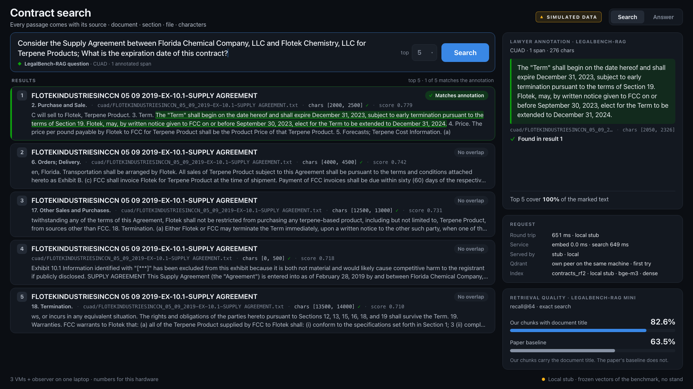

# Витрина: сцены ролика

Две страницы для англоязычного ролика (~3 мин) и сервер к ним на стандартной библиотеке Python.
Сервер слушает только 127.0.0.1, у страниц нет внешних ресурсов, всё в кадре по-английски.

| Адрес | Сцена ролика | Что на экране |
|---|---|---|
| `http://127.0.0.1:8095/` | поиск, 0:15–0:40 | вопрос → top-k кусков живого сервиса с адресом источника (документ, раздел, файл, знаки `[start, end]`); разметка юристов LegalBench-RAG зелёным там, где кусок с ней пересекается; полоса качества; вкладка Answer |
| `http://127.0.0.1:8095/board` | доска чисел, 2:50–3:00 | крупные числа из `numbers.json` и подпись про ноутбук |



## Запуск

```bash
python3 -I -B showcase/server.py           # живой стенд: вход https://192.168.105.2
python3 -I -B showcase/server.py --stub    # без стенда: заглушка входа по кэшу замера
```

Живому режиму нужны файлы, которые пишет `deploy/observer/install.sh`: `runs/stand-ca.pem` (УЦ стенда)
и `runs/entry-api-key.header` (строка `X-API-Key: …`). Чего не хватает, сервер пишет при запуске
(«НЕ ГОТОВ: …»), а страница внизу справа. Флаги: `--entry`, `--ca`, `--key-header-file`, `--data`,
`--port`, `--timeout` (поиск, 10 с), `--answer-timeout` (ответ модели, 170 с), `--verbose`.

`--stub` — репетиция без стенда: точный поиск по `cache/stage1/naive500_title` (те же куски и векторы,
что в `contracts_rf2`), вектор вопроса из кэша, поэтому понимает только вопросы мини-набора. Ответ на
`/answer` синтетический (`--stub-answer answered|refused|unsupported|busy|invalid`), но проходит ту же
проверку цитат, что сервис. На странице плашка **SIMULATED DATA**: в ролик это не идёт.

## Что откуда

| На экране | Откуда |
|---|---|
| куски, score, раздел, файл, знаки, кто ответил, время | `/search` и `/answer` входа стенда как есть (`app/api.py`), через прокси сервера |
| зелёная подсветка, «Matches annotation», «Found in result N», «Top k cover N%» | `data/legalbenchrag`: вопрос ищется в наборе, пересечение по знакам считает `truth.py`, recall по формуле авторов (`eval/legalbench.py`) |
| ✓ после знаков | `doc[start:end]` исходного файла совпал с текстом куска |
| полоса качества, подпись, вся доска | `numbers.json` через `numbers.py`: страницы не форматируют и не придумывают чисел |

Координаты одни и те же: у куска сервиса и у фрагмента эталона это индексы символов Python в тексте
документа, прочитанного `lb.read_doc` (у мини-набора `doc[span]` совпал с разметкой у всех 1307
фрагментов). Подсветка режется на сервере: в JS индексы считаются в UTF-16.

API: `/api/config` (пресеты, адрес входа, без ключа), `/api/search?q=&k=`, `/api/answer?q=&k=`,
`/api/truth?q=`, `/api/numbers`, `/healthz`.

## Съёмка

Страница управляется адресом: `?preset=N` (1…7 из `presets.json`), `?q=…`, `?k=…`, `?tab=answer`,
`?autoplay=1` (набрать и искать сразу), `?autoplay=click` (ждать клика в поле вопроса), `?typing=20`
(мс на знак, `0` — сразу), `?still` (без анимаций). Клавиши 1–7 вне поля вопроса подставляют пресет.
Сцена 1920×1080 вписывается в любое окно.

Для `web_perform.mjs` (витрина, `docs/video-build/screen-render`): `app` —
`http://127.0.0.1:8095/?preset=1&autoplay=click`, `zoom` 0.667 (окно 1920×951 CSS px); шаги:
`["click", {"sel": "#q"}]` → `["until", {"sel": "#scene[data-state=done]"}]` → `["hl", {"sel": "#hit-1 mark.truth"}]`,
`["hl", {"sel": "#hit-1 .addr"}, "band"]`, `["hl", {"sel": "#truth .snip-text"}]`, `["hl", {"sel": "#quality"}]`.
Ещё цели: `#go`, `#k`, `#tab-answer`, `#hit-N`, `#hit-N .badge`, `#request`, `#answer`. Проверено
кликом мышью по CDP в headless Chrome: набор, поиск, у всех целей есть место на экране.

## Числа доски

`numbers.json`: значения 19.11 на пересобранном стенде; `null` — ещё не измерено, на экране «pending»
(полный корпус, p95 под нагрузкой, предел векторов, ответ модели). `"hide_pending": true` убирает
неизмеренное с доски, `"hidden": true` — одну плитку, `"tone": "good"` красит большое число зелёным.
Доска перечитывает файл раз в 2 с. Формат описан в начале `numbers.py`.

## Пресеты

Семь вопросов мини-набора, по 1–2 на набор, разметка 158–402 знака. По кэшу замера (точный поиск)
у каждого первым идёт кусок, задевший разметку; у `merger-specific-performance` разметка на стыке двух
кусков и подсвечены оба.

## Тесты

`tests/test_showcase.py`: прокси против подставного входа (ключ, ошибки, таймаут, TLS по своему УЦ на
одноразовых сертификатах), сопоставление с эталоном на маленьком наборе, `numbers.json`, защита от
вставки HTML (CSP, Host, только `textContent`), заглушка.
